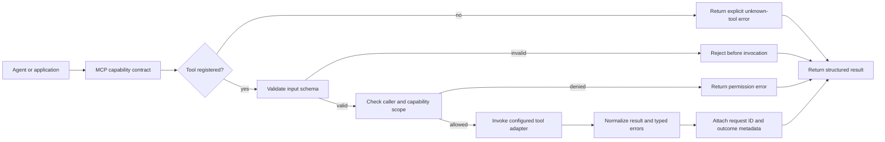

# x4-mcp

Canonical **MCP** (Model Context Protocol) server for the X4 fleet.

| Field | Value |
|-------|-------|
| Role | MCP server / registry |
| Boundary | independent-parent |
| Completion | **L0** — repository bootstrapped |
| Interface | MCP / HTTP |

## Scope

- Server registry
- Auth & permissions
- Schema validation
- Rate limiting
- Observability hooks

## Status

This repository is past the empty-initial-commit state. It ships a minimal package layout and a structural server scaffold. **No production MCP traffic is claimed** until evidence states (tests, security, CI, deployment) advance.

Related: `x4-mcp-gateway` remains the edge gateway surface; `x4-mcp` is the contract/server core.

## Development

```bash
python -m pip install -e ".[dev]"
pytest
ruff check .
```

## APEX Architecture Map

> Status: architecture documentation; implementation and deployment claims require independent verification.


**Evidence note:** This is a proposed capability-contract view for `x4-mcp`, not a claim that registry, schema validation, or authorization behavior is implemented. Confirm actual exported APIs and tests before merging.

