# X4 APEX — Composite Ecosystem Architecture

> **Status: proposed relationship map.** This is a portfolio blueprint, not a verified dependency graph. The expected `x4-spec` workflow-hub repository could not be resolved by the connected GitHub API. `x4-mcp` is the concrete, existing candidate replacement in this 30-repository set; do not assume it supplies reusable workflows. Dashed edges indicate intended or candidate relationships and must be checked against imports, package metadata, workflow references, and tests.

```mermaid
flowchart TB
  subgraph Governance["Governance and workflow"]
    MCP["x4-mcp — candidate hub substitute"]
    FLEET["x4-fleet"]
    LAB["workflow-lab"]
    SCAFFOLD["project-scaffold"]
    ARISE["arise-v9"]
  end
  subgraph Runtime["Runtime and orchestration"]
    CORE["x4-core"]
    BEAST["x4-beast"]
    AGENTS["x4-agents"]
    HARNESS["x4-harness"]
    LOCAL["x4-local-ai-runtime"]
    OMNI["omniforge"]
    ARIEXUS["ariexus"]
  end
  subgraph Policy["Safety and evidence"]
    SANDBOX["x4-sandbox"]
    APPROVAL["x4-approval"]
    AUTOFIX["x4-autofix"]
    EVIDENCE["x4-evidence"]
    CONTEXT["x4-context"]
  end
  subgraph Capabilities["Capability modules"]
    SKILLS["x4-agent-skills-hub"]
    AI["x4-ai"]
    ROUTER["x4-router"]
    RESEARCH["x4-research"]
    MEMORY["x4-memory"]
    MEMORYCORE["x4-memory-core"]
    MCPG["x4-mcp-gateway"]
    MCPPROD["x4-mcp-prod"]
    MCPGEN["x4-mcpgen"]
  end
  subgraph Quality["Quality and observability"]
    SCANNER["x4-ai-security-scanner"]
    OBS["x4-agent-observability"]
    EVAL["x4-eval"]
    EVALH["x4-eval-harness"]
  end
  CORE -. "intended runtime dependency" .-> BEAST
  CORE -. "intended orchestration dependency" .-> AGENTS
  CORE -. "intended execution boundary" .-> SANDBOX
  BEAST -. "candidate integration" .-> APPROVAL
  BEAST -. "candidate scanning integration" .-> SCANNER
  AGENTS -. "candidate skill lookup" .-> SKILLS
  AGENTS -. "candidate telemetry" .-> OBS
  AGENTS -. "candidate context" .-> CONTEXT
  AGENTS -. "candidate research" .-> RESEARCH
  AI -. "candidate provider selection" .-> ROUTER
  MEMORYCORE -. "adapter contract candidate" .-> MEMORY
  MCPGEN -. "candidate schema generation" .-> MCPG
  MCPG -. "gateway-to-service candidate" .-> MCPPROD
  APPROVAL -. "approval evidence candidate" .-> EVIDENCE
  AUTOFIX -. "patch receipt candidate" .-> EVIDENCE
  EVAL -. "score producer candidate" .-> EVALH
  FLEET -. "audits repository state" .-> CORE
  FLEET -. "audits repository state" .-> AGENTS
  FLEET -. "audits repository state" .-> BEAST
  MCP -. "workflow hub relationship unverified" .-> LAB
  style CORE fill:#1a7f37,color:#fff
  style BEAST fill:#1a7f37,color:#fff
  style SANDBOX fill:#bf8700,color:#fff
  style MCP fill:#bf8700,color:#fff,stroke-dasharray:5 5
```

## Repository roster

| # | Repository | Architecture role |
|---:|---|---|
| 1 | [x4-core](https://github.com/dhe-cruzer69/x4-core) | Runtime kernel |
| 2 | [x4-beast](https://github.com/dhe-cruzer69/x4-beast) | HTTP runtime |
| 3 | [x4-fleet](https://github.com/dhe-cruzer69/x4-fleet) | Fleet inventory and audit |
| 4 | [x4-mcp](https://github.com/dhe-cruzer69/x4-mcp) | MCP capability contract; workflow-hub role unverified |
| 5 | [x4-sandbox](https://github.com/dhe-cruzer69/x4-sandbox) | Execution policy boundary |
| 6 | [x4-agents](https://github.com/dhe-cruzer69/x4-agents) | Agent orchestration |
| 7 | [project-scaffold](https://github.com/dhe-cruzer69/project-scaffold) | Development scaffold |
| 8 | [x4-agent-skills-hub](https://github.com/dhe-cruzer69/x4-agent-skills-hub) | Skill registry |
| 9 | [x4-ai-security-scanner](https://github.com/dhe-cruzer69/x4-ai-security-scanner) | Security scanning |
| 10 | [x4-agent-observability](https://github.com/dhe-cruzer69/x4-agent-observability) | Telemetry |
| 11 | [arise-v9](https://github.com/dhe-cruzer69/arise-v9) | Governance baseline |
| 12 | [ariexus](https://github.com/dhe-cruzer69/ariexus) | CLI execution gates |
| 13 | [omniforge](https://github.com/dhe-cruzer69/omniforge) | Local AI orchestration |
| 14 | [x4-approval](https://github.com/dhe-cruzer69/x4-approval) | Approval lifecycle |
| 15 | [x4-autofix](https://github.com/dhe-cruzer69/x4-autofix) | Patch and repair pipeline |
| 16 | [x4-context](https://github.com/dhe-cruzer69/x4-context) | Context processing |
| 17 | [x4-ai](https://github.com/dhe-cruzer69/x4-ai) | Provider abstraction |
| 18 | [x4-mcp-gateway](https://github.com/dhe-cruzer69/x4-mcp-gateway) | MCP gateway |
| 19 | [x4-memory](https://github.com/dhe-cruzer69/x4-memory) | Memory service |
| 20 | [x4-research](https://github.com/dhe-cruzer69/x4-research) | Research and citations |
| 21 | [x4-harness](https://github.com/dhe-cruzer69/x4-harness) | Agent execution harness |
| 22 | [x4-eval-harness](https://github.com/dhe-cruzer69/x4-eval-harness) | Evaluation orchestration |
| 23 | [x4-evidence](https://github.com/dhe-cruzer69/x4-evidence) | Evidence ledger |
| 24 | [x4-mcp-prod](https://github.com/dhe-cruzer69/x4-mcp-prod) | MCP service blueprint |
| 25 | [workflow-lab](https://github.com/dhe-cruzer69/workflow-lab) | Reusable workflow experiments |
| 26 | [x4-router](https://github.com/dhe-cruzer69/x4-router) | Model routing |
| 27 | [x4-memory-core](https://github.com/dhe-cruzer69/x4-memory-core) | Storage adapter contract |
| 28 | [x4-mcpgen](https://github.com/dhe-cruzer69/x4-mcpgen) | Schema generation |
| 29 | [x4-eval](https://github.com/dhe-cruzer69/x4-eval) | Evaluation scoring component |
| 30 | [x4-local-ai-runtime](https://github.com/dhe-cruzer69/x4-local-ai-runtime) | Local model lifecycle |

## Verification contract

- A dashed edge is not evidence of a runtime dependency.
- A Mermaid diagram being present does not mean it has been rendered or validated against the implementation.
- Tests and CI must be run against the relevant commit before reporting them as passing.
- A deployment claim requires a deployed URL, commit identity, and a successful health check with a UTC timestamp.
- Any missing evidence stays `NOT_VERIFIED`; it is not inferred from repository size, README text, or badges alone.
